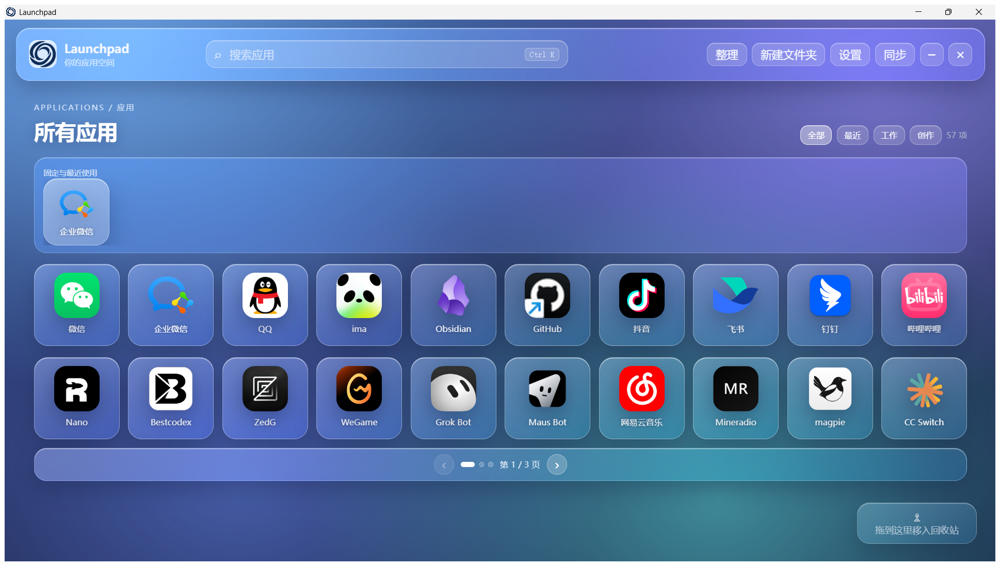
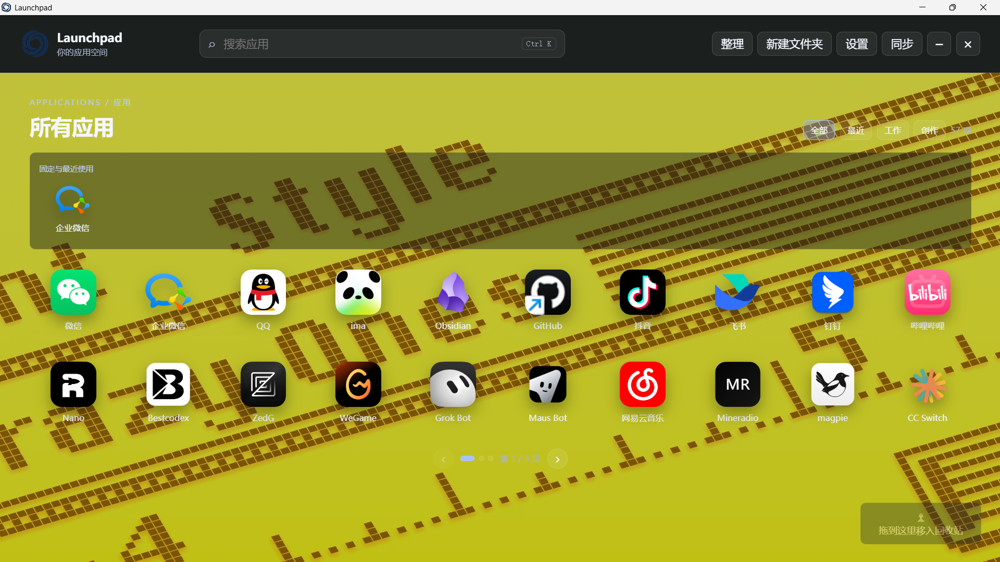

# Launchpad

一个运行在 Windows 上的 macOS Launchpad 风格应用启动台，基于 Electron 与原生 HTML / CSS / JavaScript 构建，无前端框架、无构建步骤。

## 功能

- **应用启动**：扫描 `%APPDATA%\Launchpad\QuickApps` 中的 `.lnk` / `.url` 快捷方式，保留原始启动参数与工作目录，单击即可启动
- **图标提取**：通过 Win32 `PrivateExtractIcons` 提取最高 256px 的真实程序图标，按路径与修改时间缓存
- **搜索**：按应用名称与目标路径实时过滤，`Ctrl + K` 聚焦搜索框
- **分类筛选**：全部 / 最近 / 工作 / 创作
- **分页**：自动按窗口尺寸计算每页容量，支持左右翻页、底部圆点与左右方向键
- **整理模式**：拖拽排序、跨页拖拽（拖到网格左右边缘自动翻页）、多选建文件夹、文件夹重命名与删除（内联对话框，Enter 提交 / Esc 取消）
- **回收站**：拖入回收站只把 `.lnk` 移入 Windows 回收站，不卸载软件
- **桌面同步**：把桌面上的快捷方式批量移入应用目录
- **壁纸**：跟随系统桌面壁纸，或单独选择 Wallpaper Engine 本地壁纸（图片 / 视频 / Web）
- **外观主题**：壁纸模式与 macOS 天气风格毛玻璃模式互斥切换；图标卡片可选无卡片 / 半透明卡片，并可调背景渐变强度
- **外观设置**：窗口透明度、图标大小、每行数量、壁纸亮度
- **窗口行为**：启动即最大化；关闭窗口直接退出，不常驻后台、不保留托盘
- **单实例**：重复启动会激活已有窗口
- **开机自启**：设置面板中可开启，默认关闭（仅打包版生效）
- **可访问性**：键盘方向键导航与翻页、卡片焦点可见、尊重系统「减弱动画」偏好


## 技术栈

- Electron 35.x
- electron-packager（打包 Windows x64 绿色目录）
- 原生 HTML / CSS / JavaScript
- Windows PowerShell：仅用于读取 `.lnk`、提取图标、启动进程

## 目录结构

```text
Launchpad/
├─ LaunchpadElectron/
│  ├─ main.js                        主进程：扫描、图标、配置、启动、回收、壁纸
│  ├─ preload.js                     contextBridge 暴露的白名单 IPC
│  ├─ renderer.js                    渲染、搜索、分页、拖拽、文件夹、设置
│  ├─ index.html                     页面结构
│  ├─ style.css                      样式与动画
│  ├─ package.json                   npm 脚本与依赖
│  ├─ Set-DesktopElectronShortcut.ps1 生成桌面快捷方式
│  ├─ assets/icon.png / icon.ico     应用与窗口图标
│  ├─ assets/social/                 可公开的界面预览图
│  └─ test/smoke.js                  冒烟测试
├─ verify_electron_launchpad.js      验证总入口（依次运行下面两个）
├─ verify_source.js                  源码静态一致性检查（不依赖 dist）
├─ verify_packaged.js                打包产物一致性检查（dist 缺失时跳过）
├─ verify_chinese_shortcut.js        中文快捷方式编码校验
├─ Launchpad项目说明书.md            详细项目说明书
├─ LICENSE                           PolyForm Noncommercial 许可证
└─ reasonix.toml                     本地工作区配置
```

## 环境要求

- Windows 10 / 11
- Node.js 18+
- 可选：Steam 与 Wallpaper Engine（仅使用壁纸功能时需要）

## 安装与运行

发布版是 Windows x64 绿色目录，解压后直接运行 `Launchpad.exe`。源码运行需要 Node.js 18+：

```powershell
Set-Location "LaunchpadElectron"
npm install
npm start
```

## 常用脚本

在 `LaunchpadElectron/` 下执行：

```powershell
npm run check           # 语法检查 main.js / preload.js / renderer.js
npm test                # 冒烟测试
npm run verify          # check + test + 源码静态检查
npm run verify:source   # 仅源码静态检查
npm run verify:packaged # 仅打包产物检查（dist 缺失时跳过）
npm run package         # 打包到 dist/Launchpad-win32-x64/
```

在仓库根目录执行：

```powershell
node verify_electron_launchpad.js   # 依次运行 verify_source.js 与 verify_packaged.js
node verify_chinese_shortcut.js     # 需要本机存在 %APPDATA%\Launchpad\QuickApps\钉钉.lnk
```

`verify_source.js` 做的是动态一致性检查，而不是字符串匹配：它会比对 `main.js` 的 IPC 通道集合与 `preload.js` 的 `invoke` 集合是否完全相等、`renderer.js` 引用的每个 `$('id')` 是否都存在于 `index.html`、入站通道数量是否与 `assertTrustedEvent` 调用数一致。

打包完成后可运行 `Set-DesktopElectronShortcut.ps1` 更新桌面快捷方式。

## 界面预览

第一页使用实际整理后的应用顺序，分别展示两种互斥外观模式：

### 毛玻璃模式



### Wallpaper 壁纸模式



截图仅展示应用启动台界面；应用列表和壁纸来自本机运行环境，不会写入发布版数据。

## 数据位置

应用快捷方式默认读取：

```text
%APPDATA%\Launchpad\QuickApps\*.lnk
```

可用环境变量 `LAUNCHPAD_DATA_DIR` 改整个数据根目录，或用 `LAUNCHPAD_APP_DIR` 单独指定快捷方式目录。

首次运行新版时会自动把旧版桌面 `QuickApps` 目录迁移过来并删除旧目录，无需手动处理。

配置保存在 `%APPDATA%\Launchpad\config\`：

- `electron-launchpad-order.json`：应用排序
- `electron-launchpad-state.json`：最近使用、固定项、文件夹、界面设置、窗口位置

图标缓存位于 `%TEMP%\ReasonixElectronIcons`。

## 壁纸

- `desktop`：读取注册表 `HKCU:\Control Panel\Desktop` 的 `WallPaper`，并回退到 Wallpaper Engine 生成的覆盖图
- `custom`：扫描各 Steam 库的 `steamapps\workshop\content\431960`，支持图片、视频、Web 三种媒体

`scene.pkg` 场景壁纸无法直接渲染，请在 Wallpaper Engine 中设为桌面壁纸后使用「跟随系统桌面壁纸」模式。不要用预览图或缩略图伪装实时画面。

## 安全设计

- `contextIsolation: true`、`nodeIntegration: false`、`sandbox: true`
- 页面启用 CSP，脚本仅允许同源
- 每个 IPC 调用都校验来源窗口、主 frame 与本地页面 URL
- 禁止外部导航与新窗口
- 启动目标仅限当前可见的快捷方式，且仅允许普通文件或 `http/https`
- PowerShell 参数通过 JSON 环境变量传递，不做字符串拼接
- 渲染层仅使用 `textContent` 与 DOM API

## 许可证

本项目采用 [PolyForm Noncommercial License 1.0.0](LICENSE)。允许个人和非商业项目使用、修改与分发；未经许可不得用于商业活动。

## 说明

打包产物（`LaunchpadElectron/dist/`）与 `node_modules/` 不纳入版本控制，请本地执行 `npm run package` 生成。
